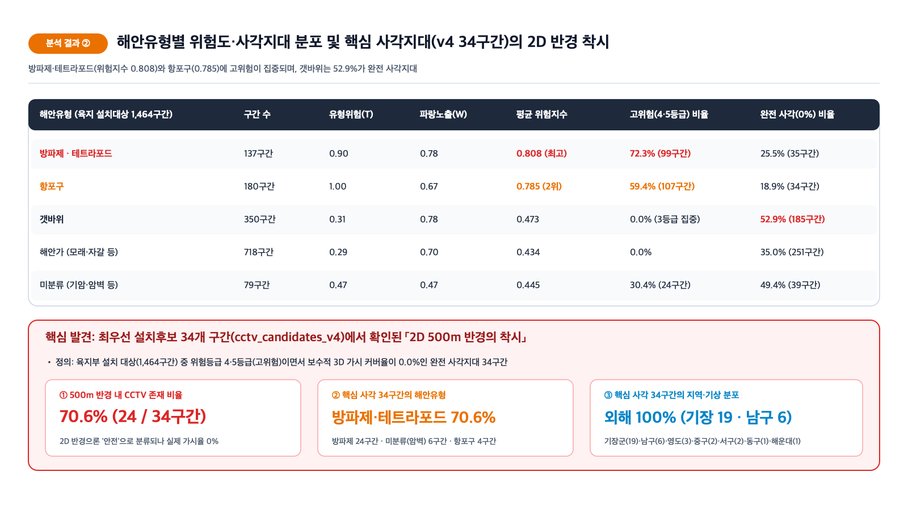

# [섹션 4] 분석 결과 (포스터 판넬 & 최종 보고서 작성용)

> **포함된 하얀색 배경 시각화 자료 (`./`)**:
> 1. [`fig06_구군별_기존CCTV현황_및_실질사각지대_white.png`](./fig06_구군별_기존CCTV현황_및_실질사각지대_white.png) — 구·군별 기존 CCTV 분포 현황: 2D 500m 반경 커버율(70.6%) vs 3D 실제 가시 커버율(25.1%) 및 미커버 사각지대(74.9%) 비교 (하얀 배경)
> 2. [`fig07_해안유형별_위험지수_및_사각지대비율_white.png`](./fig07_해안유형별_위험지수_및_사각지대비율_white.png) — 해안유형별 위험지수·사각지대 비율 및 핵심 미커버 사각(`v4` 34구간)의 2D 반경 착시 인포그래픽 (하얀 배경)
> 3. [`fig08_균등배치_vs_위험도가중배치_성과비교_white.png`](./fig08_균등배치_vs_위험도가중배치_성과비교_white.png) — 신규 CCTV 설치 시 면적 균등 배치 vs 위험도 가중 배치(10·20·50대) 성과 비교 및 구·군별 배분 변화 (하얀 배경)
> 4. [`map01_부산전체_3분류가시커버율_및_상위50곳촬영방향.png`](./map01_부산전체_3분류가시커버율_및_상위50곳촬영방향.png) — 부산 전체 기존 CCTV 가시 커버율 및 신규 상위 50곳 최적 촬영방향 지도 (하얀 배경)
> 5. [`map02_핵심사각34구간_v4_및_위험가중상위50곳.png`](./map02_핵심사각34구간_v4_및_위험가중상위50곳.png) — 핵심 고위험 사각 34구간(`v4`) 및 위험도 가중 신규 배치 상위 50곳 지도 (하얀 배경)
> 6. [`map03_신규CCTV대수별_커버율곡선.png`](./map03_신규CCTV대수별_커버율곡선.png) — 신규 설치 대수(N)별 해안 커버율 한계효용 곡선 (하얀 배경)
> 7. [`map04_확대지도_기장군.png`](./map04_확대지도_기장군.png), [`map05_확대지도_강서사하구.png`](./map05_확대지도_강서사하구.png) — 권역별 상세 확대 지도

---

## 파트 A. 포스터 판넬용 문안 (`우리팀_(테트라워치)포스터양식.pdf` 맞춤)

### [포스터 「분석 결과」 박스 (핵심 그래프 + 시사점 개조식 요약)]

- **결과 1. 기존 CCTV 분포 및 구·군별 해안선 커버 현황 진단 (`2D 70.6% vs 3D 실제 25.1%`)**
  - 기존 통합 CCTV 12,808곳(해안 인접 1,782곳)이 실제로 커버하는 부산 해안 면적은 **25.1%(1,474.1ha)**에 불과하며, **74.9%(4,399.5ha)가 미커버 사각지대**임
  - 수영구(실제 가시 99.6%)를 제외한 전 구·군에서 2D 500m 반경 커버율과 3D 실제 가시율 간 큰 괴리가 발생하며, **사하구(실제가시 12.2% · 사각 87.8%), 강서구(12.4% · 사각 87.6%), 동구(14.2% · 사각 85.8%), 남구(15.1% · 사각 84.9%), 영도구(26.7% · 사각 73.3%), 해운대구(39.9% · 사각 60.1%)** 순으로 미커버 해안선이 광범위하게 분포함

- **결과 2. 미커버 사각지대의 위험도 특성 및 핵심 사각 34구간(`v4`)의 「2D 반경 착시」 규명**
  - 육지 설치대상 1,464구간 중 **방파제·테트라포드는 평균 위험지수 최고(0.808, 고위험 72.3%)임에도 25.5%(35구간)가 완전 미커버(0%)** 상태이며, 외해 파랑노출($W=0.78$)이 가장 높은 **갯바위는 절반 이상인 52.9%(185구간)가 완전 사각**으로 방치됨
  - 고위험(4·5등급)이면서 실제 가시율이 0%인 **핵심 미커버 사각 34구간(`v4`: 기장 19, 남구 6, 영도 3 등 외해 100%, 방파제·테트라포드 70.6%)** 중 무려 **70.6%(24구간)는 반경 500m 내에 기존 CCTV가 존재**하나 지형 차폐·내륙 지향으로 인해 실제로는 바다가 전혀 보이지 않는 착시 구간임이 입증됨

- **결과 3. 미커버 해안선 신규 CCTV 최적 입지 선정: 「면적 균등 배치 vs 위험도 가중 배치(50곳)」**
  - 미커버 해안선에 신규 50대를 **단순 면적 균등 배치**할 경우 서부산 저위험 광역 해안(사하 13·강서 11)에 편중되어 핵심 고위험 사각(`v4` 34구간) 커버율이 **47.8%**에 그침
  - 반면 **위험도 가중 배치** 적용 시 **기장군(14곳)·남구(7곳)·영도구(7곳)·사하구(6곳)·동구(5곳)·해운대구(4곳)**의 고위험 미커버 항포구(20곳)·해안가(14곳)·갯바위(9곳)·방파제(7곳)가 선정되어, 전체 면적 커버율 손실은 1.7%p(45.6%→43.9%)에 불과하면서 **핵심 고위험 사각(`v4`) 커버율은 61.3%(+13.5%p)**로 급상승함 (초기 10대 설치 시 균등 17.5% vs 위험가중 **37.6%로 2.15배 효율**)

---

## 파트 B. 최종 보고서용 본문 (`부경대_최우수상_사례집(보고서).pdf` 양식 참조)

### Ⅴ. 분석 결과

#### 1. 기존 CCTV 위치·현황에 따른 구·군별 해안선 커버리지 및 실질 사각지대 진단
기존 해안 인접 CCTV 1,782곳의 현재 위치·설치목적·화각에 3D Viewshed 모델을 적용하여 산출한 구·군별 실제 가시 커버율과 기존 2D 500m 반경 커버율을 비교하면 `<그림 3>`([`fig06_구군별_기존CCTV현황_및_실질사각지대_white.png`](./fig06_구군별_기존CCTV현황_및_실질사각지대_white.png))과 같다.

부산 전체 해안 대상구역 5,873.6ha 중 기존 CCTV가 실제로 커버하고 있는 면적은 **1,474.1ha(25.1%)**에 불과하며, 나머지 **4,399.5ha(74.9%)는 기존 CCTV의 시야가 닿지 않는 실질적 미커버 사각지대**로 나타났다. 구·군별 현황을 보면, 해변에 카메라가 밀집된 수영구(2D 반경 100.0% → 실제 가시 99.6%)를 제외한 모든 구·군에서 2D 반경 커버율 대비 실제 가시율이 크게 하락하였다. 특히 해운대구(2D 100.0% → 실제 39.9%, 미커버 사각 60.1%), 동구(2D 82.6% → 실제 14.2%, 사각 85.8%), 남구(2D 80.5% → 실제 15.1%, 사각 84.9%), 영도구(2D 74.2% → 실제 26.7%, 사각 73.3%)는 해안선 인근에 기존 CCTV는 다수 존재하나 내륙 도로 감시 목적이거나 해안 절벽·구조물에 차폐되어 실제 해안선 대부분을 커버하지 못하고 있으며, **사하구(실제 가시 12.2%, 사각 87.8%)와 강서구(실제 가시 12.4%, 사각 87.6%)**는 절대적인 카메라 수 부족으로 광범위한 해안선이 비어 있는 것으로 확인되었다.

#### 2. 미커버 사각지대의 위험도 분포와 핵심 사각(`v4` 34구간)의 2D 반경 착시
해양기상 파랑노출($W$)과 해안유형 위험($T$)을 결합한 육지부 설치 대상 1,464개 구간의 위험도 및 미커버 사각지대 분포는 `<그림 4>`([`fig07_해안유형별_위험지수_및_사각지대비율_white.png`](./fig07_해안유형별_위험지수_및_사각지대비율_white.png))와 같다.

분석 결과, 추락 시 테트라포드 내부 고립으로 인명 피해 위험이 가장 높은 **방파제·테트라포드(137구간)**는 평균 위험지수가 **0.808**로 전 해안유형 중 1위이며 **72.3%(99구간)가 고위험(4·5등급)**에 해당하지만, 정작 **4곳 중 1곳인 25.5%(35구간)가 가시 커버율 0%인 완전 미커버 사각지대**로 방치되어 있었다. 선박 입출항 및 추락 사고가 빈번한 **항포구(180구간)** 역시 평균 위험지수 **0.785(고위험 비율 59.4%)**로 매우 높으나 **18.9%(34구간)가 완전 미커버 상태**였으며, 외해 파랑노출($W=0.78$)이 최고 수준인 **갯바위(350구간)는 절반 이상인 52.9%(185구간)가 완전 사각지대**로 나타났다.

특히 고위험 등급(4·5등급)이면서 육지부 설치 대상이고 가시 커버율이 0%인 **최우선 설치후보 34개 미커버 구간(`cctv_candidates_v4`)**을 도출하여 기존 2D 반경(500m) 지표와 비교한 결과(`<그림 4>` 하단 및 `<그림 5>` [`map02_핵심사각34구간_v4_및_위험가중상위50곳.png`](./map02_핵심사각34구간_v4_및_위험가중상위50곳.png)), 34개 구간 중 무려 **70.6%(24구간)가 반경 500m 이내에 기존 CCTV가 존재(`cctv_gap_500m == False`)**하는 것으로 확인되었다. 이는 단일 2차원 거리 지표만으로는 방파제 꺾임이나 해안 절벽 차폐에 가려진 고위험 미커버 해안선(기장군 19구간, 남구 6구간, 영도구 3구간 등 외해 방파제·항포구)의 70% 이상을 놓치게 된다는 점을 실증적으로 보여준다.

#### 3. 미커버 해안선 신규 CCTV 최적 입지 선정: 면적 균등 배치 vs 위험도 가중 배치 비교
기존 CCTV가 커버하지 못하는 해안선에 신규 CCTV(높이 8m, 가시거리 300m)를 10대, 20대, 50대 설치할 때 모든 해안구간에 동일 가중치를 부여하는 **면적 균등 배치**와 연안 위험지수($R_s$)를 가중치로 부여하는 **위험도 가중 배치**의 성과를 비교하면 `<그림 6>`([`fig08_균등배치_vs_위험도가중배치_성과비교_white.png`](./fig08_균등배치_vs_위험도가중배치_성과비교_white.png))과 같다.

- **핵심 고위험 사각(`v4` 34구간) 해소율의 극적 차이**: 초기 10대를 우선 신설할 때 면적 균등 배치는 핵심 고위험 사각지대의 **17.5%**밖에 커버하지 못하는 반면, 위험도 가중 배치는 **37.6%(+20.1%p, 2.15배 효율)**를 즉시 커버한다. 50대 신설 기준에서도 위험도 가중 배치는 전체 해안 면적 커버율을 1.7%p(45.6% → 43.9%)만 양보하면서 **위험가중 커버율을 63.9%(+3.2%p)**로 높이고, **핵심 고위험 사각지대(`v4`) 커버율을 47.8%에서 61.3%로 +13.5%p 대폭 향상**시킨다.
- **최적 신설 입지 50곳의 공간적 분포**: 면적 균등 배치 시에는 지형이 평탄하고 면적이 넓은 서부산 저위험 해안가(사하구 13대, 강서구 11대)에 절반 가까운 카메라가 배분되나, 위험도 가중 배치 시에는 외해 파랑노출과 사고 위험이 집중된 **기장군(14곳, 28%)·남구(7곳, 14%)·영도구(7곳, 14%)·사하구(6곳, 12%)·동구(5곳, 10%)·해운대구(4곳, 8%)·서구(3곳, 6%)·중구(2곳, 4%)·강서구(2곳, 4%)**의 미커버 항포구(20곳)·해안가(14곳)·갯바위(9곳)·방파제(7곳)가 최적 입지로 도출되어 총 **+742.2ha**의 신규 가시 면적을 확보한다(`<그림 7>` [`map01_부산전체_3분류가시커버율_및_상위50곳촬영방향.png`](./map01_부산전체_3분류가시커버율_및_상위50곳촬영방향.png) 참조).
