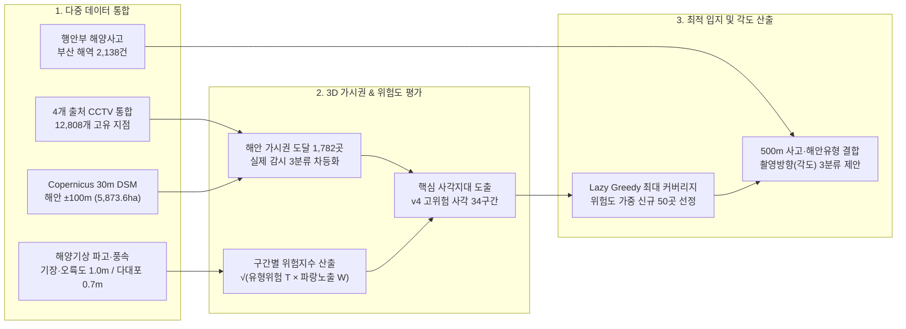
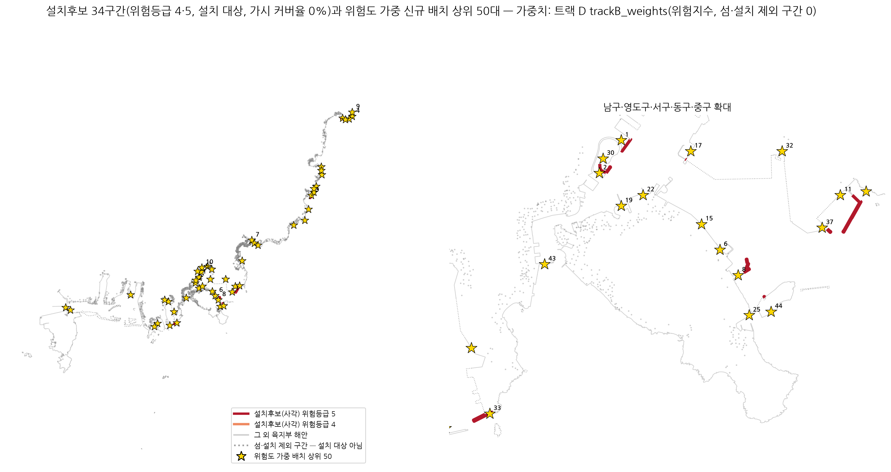
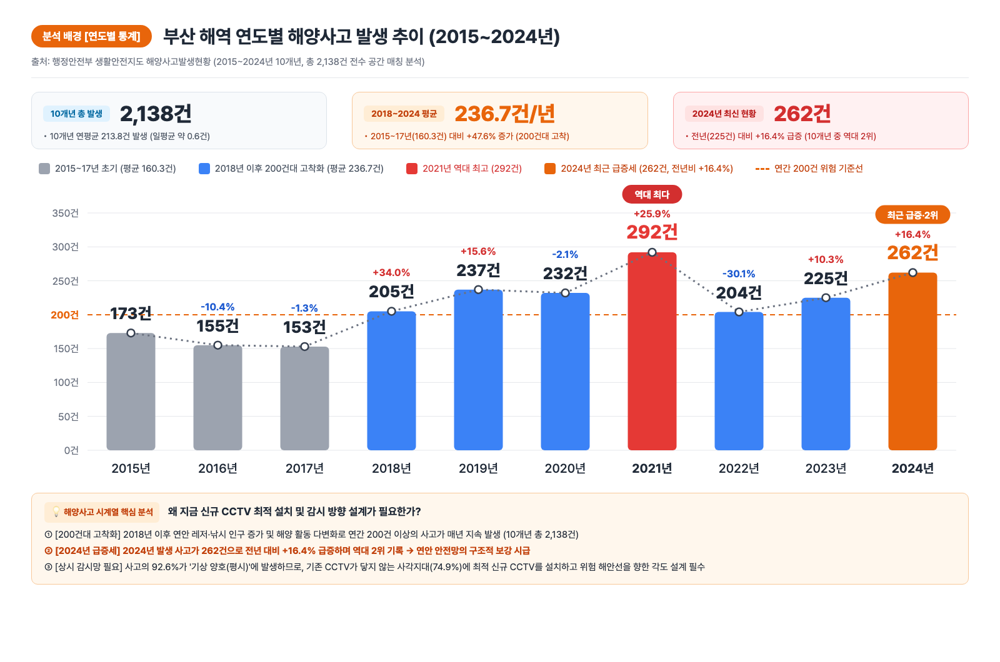
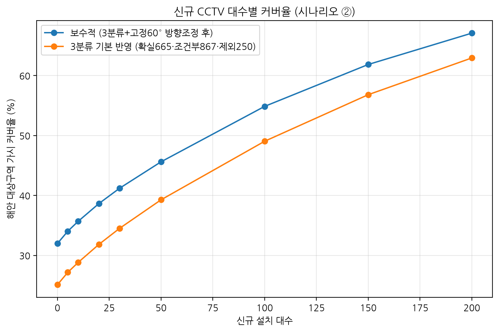
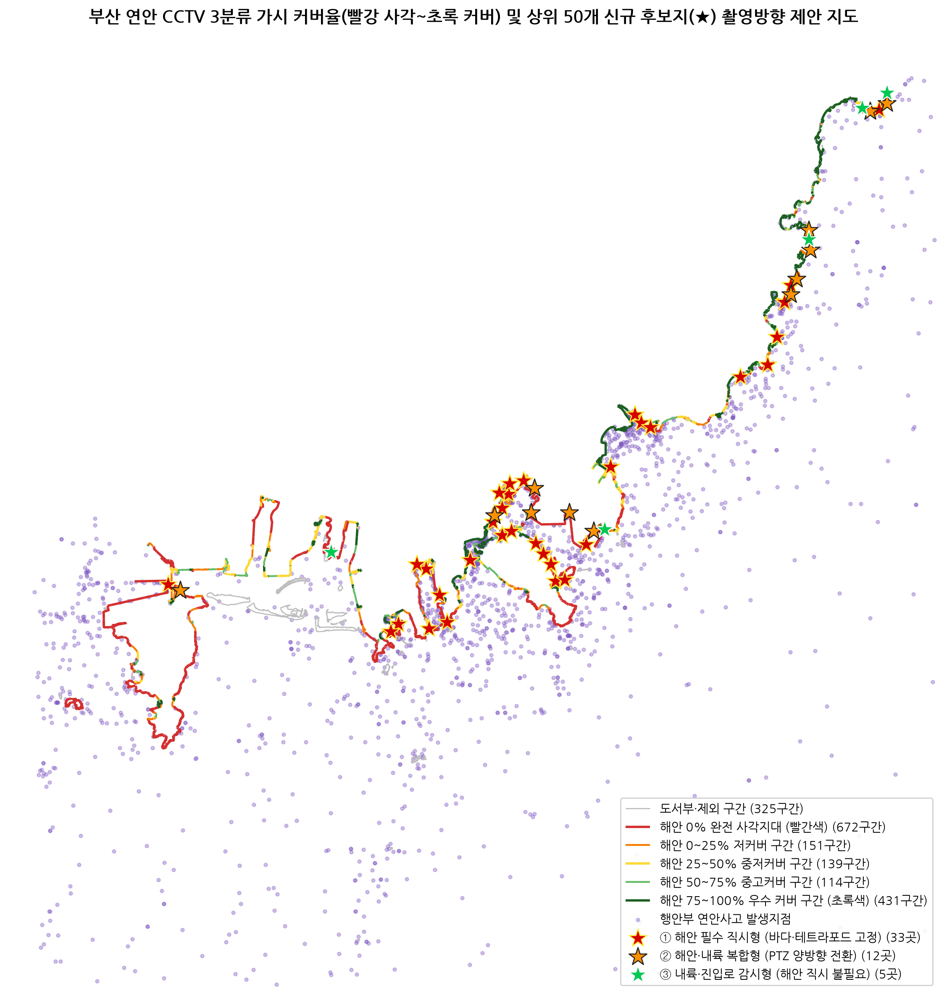
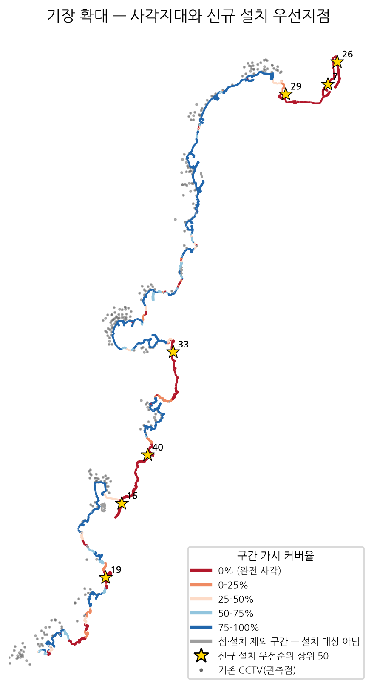
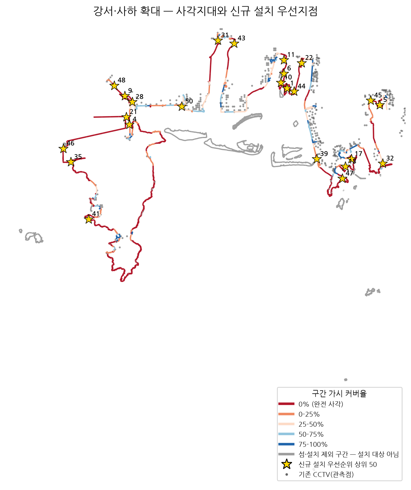

# 부산 연안 CCTV · 해양기상 · 연안사고·해양사고 통합 데이터 심층 분석 종합보고서

> **분석 범위**: 부산시 전체 해안선 **1,832개 구간(대상면적 5,873.6ha)**  
> **통합 데이터**: ① 4개 출처 통합 CCTV(**12,808곳**, 해안 가시권 도달 **1,782곳**) · ② Copernicus GLO-30 3D 지형·수치표면모델(DSM) 가시권(Viewshed) · ③ 권역별 해양기상 파랑노출 및 파고 임계치 · ④ 해양경찰청 연안 장소별 사고발생이력(**397건**) · ⑤ 행정안전부 부산 해역 해양사고(**2,138건**)  
> **관련 상세 문서**:
> - [02_신규후보지_상위50곳_및_핵심사각지대34곳_상세명세.md](./02_신규후보지_상위50곳_및_핵심사각지대34곳_상세명세.md)
> - [03_인터랙티브_분석대시보드.html](./03_인터랙티브_분석대시보드.html)
> - [부산 사각지대 및 신규 후보지 인터랙티브 지도 (Folium HTML)](./images/busan_blind_and_new_sites.html)

---

## 1. 데이터 통합 파이프라인 및 분석 아키텍처

---

## 2. 특징 ①: 기존 CCTV 분포와 「2D 반경(70.6%) vs 3D 실제 가시권(25.1%)」의 착시

### 2-1. 4개 출처 CCTV 데이터 통합 전·후 비교
기존 방식처럼 **교통 CCTV(238곳)**만 활용할 경우 해안 1,832개 구간 중 500m 반경 내 커버 구간은 **15.2%(279구간)**에 불과해 **84.8%가 감시 공백**으로 분류됩니다. 반면 행정안전부 생활안전 CCTV(12,429곳·26,840대), 부산 ITS(315곳), 재난예경보(81곳)를 20m 반경 중복 제거로 통합한 **12,808곳**을 적용하면 **500m 반경 기준 커버리지는 70.6%(1,293구간)**까지 상승합니다(최근접 거리 중앙값 182.5m).

| 지표 항목 | 수치 | 비고 |
| :--- | :---: | :--- |
| 기존 교통 CCTV 위치 수 | 238곳 | 500m 반경 커버리지 **15.2%** (279 / 1,832구간) |
| 행안부 고유 설치지점 (카메라 대수 합) | 12,429곳 (26,840대) | 유효 좌표 행 18,054행 기준 |
| 부산 ITS / 재난예경보 CCTV 위치 | 315곳 / 81곳 | 20m 반경 내 중복 지점 병합 |
| **통합 고유 CCTV 위치 수** | **12,808곳** | 500m 반경 커버리지 **70.6%** (1,293 / 1,832구간) |
| 해안선 1km 이내 관측점 | 3,856곳 | 그중 해안 대상구역 도달 가능(`can_reach_zone`) **1,782곳** |
| **3D 실제 가시 커버율 (3분류 반영)** | **25.1%** | 대상구역 5,873.6ha 중 **1,474.1ha만 실제 가시 확보** |

> [!IMPORTANT]
> **핵심 인사이트 — "반경 500m 안에 카메라가 있다(70.6%)" ≠ "실제로 바다가 보인다(25.1%)"**  
> 해안 가시거리(300m) 내 도달 가능한 **1,782곳**을 대상으로 지형 차폐(DSM), 촬영방면(화각), 설치목적, 해안거리를 결합해 3분류로 검증한 결과, **실제 부산 해안 가시 커버율은 25.1%(1,474.1ha / 5,873.6ha)**에 불과하며 **74.9%(4,399.5ha)가 실질적 사각지대**로 밝혀졌습니다.

### 2-2. 해안 인접 CCTV 1,782곳의 실제 해양 감시 3분류(6세부유형)

| 3분류 그룹 | 세부 유형 및 판정 근거 | 관측점 수 | 비중 | Viewshed 반영 방식 |
| :--- | :--- | :---: | :---: | :--- |
| **🟢 1. 해양 확실 감시** | `1-1.` 지형 가시(`omni > 0`) + **360° 회전형(`ptz_360`)** (방범·다목적 등) | 516곳 | 29.0% | **100% 반영** (360° 전방위) |
| *(소계: 665곳, 37.3%)* | `1-2.` 지형 가시(`omni > 0`) + **`재난재해`·`시설물관리`** 목적 | 149곳 | 8.4% | **100% 반영** (최근접 해안 직시, 60°/90°) |
| **🟡 2. 조건부 부분 감시** | `2-1.` 지형 가시(`omni > 0`) + 고정/미상 + **해안 50m 이내 초근접** | 137곳 | 7.7% | **해안 직시 고정 60°** 반영 |
| *(소계: 867곳, 48.7%)* | `2-2.` 지형 가시(`omni > 0`) + 고정/미상 + **해안 50~400m 내륙** | 730곳 | 41.0% | **해안 직시 해제** (+60° 오프셋 비스듬히 반영) |
| **🔴 3. 해양 미감시(제외)** | `3-1.` **3D 지형 완전 차폐 (`omni == 0ha`)** — 언덕·지형에 가려 바다 안 보임 | 124곳 | 7.0% | **완전 제외 (0%)** |
| *(소계: 250곳, 14.0%)* | `3-2.` **`어린이보호`(스쿨존)** 및 **`교통단속`(차선·번호판 전용)** | 126곳 | 7.1% | **완전 제외 (0%)** |

### 2-3. 구·군별 해안 커버리지 양극화와 「방향 회전(시나리오 ①)」 잠재력

| 구·군 | 해안구간 수 | 대상면적(ha) | 500m 반경 커버율 | **3D 현재 가시율(3분류)** | **360° 상한 가시율** | **방향 회전 개선폭(`rotate_gain`)** | 지역별 핵심 특징 |
| :--- | :---: | :---: | :---: | :---: | :---: | :---: | :--- |
| **수영구** | 22 | 117.8 | 100.0% | **99.6%** | 99.8% | +0.2%p | 광안리 해변 밀집 배치로 사각지대 거의 없음 |
| **기장군** | 502 | 808.0 | 83.5% | **57.2%** | 60.0% | +2.8%p | 재난·안전 CCTV 다수이나 외해 방파제 국소 사각 존재 |
| **중구** | 19 | 93.9 | 89.5% | **52.3%** | 53.2% | +0.9%p | 도심 항만 인접, 고정형 비중 낮음 |
| **해운대구** | 118 | 273.4 | 100.0% | **39.9%** | **77.7%** | **+37.8%p** | **카메라는 많으나 내륙 도로 지향 → 방향 조정 시 최대 수혜** |
| **서구** | 56 | 259.0 | 73.2% | **39.0%** | 40.4% | +1.4%p | 암남공원·송도 기암절벽 지형 차폐 영향 |
| **영도구** | 178 | 599.2 | 74.2% | **26.7%** | 43.2% | **+16.5%p** | 해안 절벽 및 항포구 배후 카메라 방향 조정 여지 큼 |
| **남구** | 118 | 492.8 | 80.5% | **15.1%** | 31.9% | **+16.8%p** | 오륙도·이기대 해안절벽 지형 차폐 + 내륙 지향 카메라 다수 |
| **동구** | 23 | 147.3 | 82.6% | **14.2%** | 30.7% | **+16.5%p** | 북항 항포구 구조물 차폐 및 사고 밀집 |
| **강서구** | 460 | 1,886.5 | 55.2% | **12.4%** | 30.1% | **+17.7%p** | 광활한 삼각주·신항만 해안선 대비 절대 대수 부족 |
| **사하구** | 336 | 1,195.6 | 52.4% | **12.2%** | 22.7% | +10.5%p | 다대포·장림포구 일대 **부산 최저 가시 커버율** |
| **부산 전체** | **1,832** | **5,873.6** | **70.6%** | **25.1%** | **37.7%** | **+12.6%p** | **기존 25.1% 진단 → 미커버 74.9% 사각지대 대상 신규 50곳 최적 입지 및 촬영방향 설계로 +742.2ha 가시권 확보** |

---

## 3. 특징 ②: 사각지대의 해양기상·지형 위험도와 「고위험 방파제·갯바위 노출」

### 3-1. 해양기상(파고·풍속) × 해안유형 결합 위험도 특성
전체 1,832개 구간은 해양기상 노출 특성에 따라 **외해 1,036구간(기장 관측소 620구간·파고임계 1.0m, 오륙도 관측소 416구간·파고임계 1.0m)**과 **내만 796구간(다대포 관측소 796구간·파고임계 0.7m, 풍속임계 공통 16.9m/s)**으로 배정되며, 구간별 위험지수는 $\sqrt{T_{\text{유형위험}} \times W_{\text{파랑노출}}}$로 산출되었습니다.

도서부(325구간) 및 항만보안·거가대교 수동제외 구역 등 설치 제외 구간(368구간)을 뺀 **육지부 실제 설치대상 1,464구간**의 해안유형별 위험도와 사각지대 분포는 다음과 같습니다:

| 해안유형 (육지 설치대상) | 구간 수 | 평균 유형위험($T$) | 평균 파랑노출($W$) | **평균 위험지수** | **고위험(4·5등급) 비율** | **보수적 완전 사각(0%) 비율** | 구조적 취약성 요약 |
| :--- | :---: | :---: | :---: | :---: | :---: | :---: | :--- |
| **방파제·테트라포드** | 137구간 | 0.90 | 0.78 | **0.808 (최고)** | **72.3% (99구간)** | **24.8% (34구간)** | 추락 시 자력 탈출이 불가능한 고위험 지형이나 4곳 중 1곳이 완전 사각 |
| **항포구** | 180구간 | 1.00 | 0.67 | **0.785** | **59.4% (107구간)** | **17.8% (32구간)** | 어선·레저선박 입출항 및 방파제 인접으로 사고 최다발 |
| **갯바위** | 350구간 | 0.31 | 0.78 | 0.473 | 0.0% (3등급 집중) | **50.6% (177구간)** | 외해 파랑노출($W=0.78$) 최고 수준이나 **절반 이상이 감시 사각지대** |
| **해안가 (모래·자갈 등)** | 718구간 | 0.29 | 0.70 | 0.434 | 0.0% | 31.9% (229구간) | 서부산(강서·사하) 외곽 광역 해안에 사각지대 집중 |
| **미분류 (기암·암벽 등)** | 79구간 | 0.47 | 0.47 | 0.445 | 30.4% (24구간) | **35.4% (28구간)** | 영도·남구·기장 급경사 해안절벽 지형 차폐 심각 |

### 3-2. 핵심 설치후보 34구간(`cctv_candidates_v4`)에서 드러난 500m 반경의 함정
위험등급 4·5등급(고위험)이면서 육지부 설치 대상이고 보수적 가시 커버율이 0%인 **최우선 사각지대 34구간**을 분석한 결과:
- **지역 분포**: **기장군 19구간(55.9%)**, 남구 6구간(17.6%), 영도구 3구간(8.8%), 중구·서구 각 2구간, 동구·해운대구 각 1구간으로, **100% 외해 권역(기장 관측소 20구간, 오륙도 관측소 14구간)**에 위치합니다.
- **해안 유형**: **방파제·테트라포드가 24구간(70.6%)**으로 압도적이며, 미분류 6구간(17.6%), 항포구 4구간(11.8%)입니다.
- **2D 반경의 착시**: 34개 구간 중 **29.4%(10구간)는 반경 500m 이내에 이미 CCTV가 존재(`cctv_gap_500m == False`)**합니다. 즉 이 구간들은 기존 2차원 반경 분석에서는 "이미 커버된 지역"으로 빠져 있었으나, 3D 지형 차폐와 카메라 방향을 반영한 Viewshed 분석을 통해서야 **실제로는 가시율이 0%인 치명적 사각지대**임이 규명되었습니다.

### 3-3. 행정안전부 해양사고(2,138건) 결합 특성 및 연도별 발생 추이
- **연도별 발생 추이 (2018년 이후 200건대 고착화 및 2024년 급증세)**:
  - 10개년(2015~2024년) 총 2,138건의 연도별 발생 추이를 분석한 결과, 2015~2017년 연평균 160.3건에서 **2018년 이후 연평균 236.7건(+47.6%)**으로 급증하여 200건대가 고착화되었습니다.
  - 특히 **2024년 사고 건수는 262건**으로 전년(225건) 대비 **+16.4% 급증**하며 10개년 중 역대 2위를 기록, 최근 연안 레저·관광 인구 증가 및 기상 변동성에 따른 안전 인프라 확충의 시급성을 실증합니다.
- **기상 '양호' 상태 사고가 92.6%(1,979건)**: 풍랑주의보(54건)·저시정(37건)·황천(47건)·태풍경보(12건) 등 기상특보 시점보다 **평온한 날('양호')에 발생한 사고가 92.6%**를 차지합니다.
- **사고 유형 및 원인**: 기관손상(633건), 충돌(217건), 해양오염(178건), 화재(126건), 추진기손상(119건), 운항저해(115건), 부유물감김(114건), 접촉(107건), 침수(100건), 표류(77건) 순이며, 원인은 정비불량(802건)·운항부주의(578건)·관리소홀(221건)·안전부주의(126건) 등 인적 요인이 지배적입니다.
- **발생 해역**: **항계 내(1,211건, 56.6%)** 및 **연안 영해(879건, 41.1%)**에 집중되어 있어, 기상특보 연동 통제뿐 아니라 **항포구·방파제에 대한 24시간 상시 시각 감시 체계**가 필수적입니다.

---

## 4. 특징 ③: 어디에, 어떤 각도로 설치해야 하는가? (최적 입지 50곳 & 촬영방향 3분류)

### 4-1. 면적 균등 배치 vs 위험도 가중 배치 효율 비교

| 배치 전략 | 신규 대수 | 전체 해안 면적 커버율 | 위험지수 가중 커버율 | **핵심 고위험 사각(v4 34구간) 커버율** | 주요 배치 구·군 (50대 기준) |
| :--- | :---: | :---: | :---: | :---: | :--- |
| **면적 균등 배치** | 10대 | 35.7% | 49.7% | 17.5% | 강서(12)·사하(12)·기장(9)·남구(6) 등 *(서부산 광역 저위험 해안 편중)* |
| | 20대 | 38.6% | 53.1% | 28.5% | |
| | **50대** | **45.6%** | **60.7%** | **47.8%** | |
| **위험도 가중 배치** *(Track D 권장)* | 10대 | 35.0% | 51.3% | **37.6% (+20.1%p)** | **기장(14)·남구(7)·영도(7)·사하(6)·동구(5)** 등 *(고위험 방파제·항포구 사각 집중)* |
| | 20대 | 37.5% | 55.3% | **46.7% (+18.2%p)** | |
| | **50대** | **43.9%** | **63.9% (+3.2%p)** | **61.3% (+13.5%p)** | |

### 4-2. 신규 상위 50개 후보지의 촬영 각도(방위각) 및 운영 방식 3분류

선정된 상위 50개 후보지(총 **+742.2ha** 신규 가시 면적 확보)에 대해 반경 500m 내 해양사고 건수·중대 사고 여부·해안 지형 유형을 결합하여 **최적 촬영 각도 및 카메라 운영 방식을 3가지로 분류**했습니다:

| 촬영방향·각도 분류 | 선정 기준 | 후보지 수 (비중) | 신규 확보 면적 | 반경 500m 평균 사고 | 주요 분포 지역 및 해안유형 | 권장 설치 각도 및 운영 전략 |
| :--- | :--- | :---: | :---: | :---: | :--- | :--- |
| **🔴 ① 해안 필수 직시형** *(바다·테트라포드 고정)* | 500m 내 사고 3건 이상 또는 중대사고 2건 이상 + 방파제/갯바위/암벽 | **33곳 (66%)** | **497.4ha** *(평균 15.1ha)* | **13.4건** *(중대 12.1건)* | **영도(7)·동구(5)·기장(5)·사하(5)·해운대(4)** 항포구(15), 해안가(9), 방파제(5), 갯바위(4) | 최근접 해안선 및 테트라포드 끝단 방위각(`nearest_coast_azimuth_deg`)으로 **주 화각을 바다 쪽에 고정 직시**하여 추락·익수·항내 충돌 상시 감시 |
| **🟠 ② 해안·내륙 복합형** *(PTZ 양방향 전환)* | 500m 내 사고 1~2건 또는 항포구·해수욕장 접점 | **12곳 (24%)** | **165.4ha** *(평균 13.8ha)* | **1.25건** *(중대 0.8건)* | **기장(6)·남구(4)·중구(1)·강서(1)** 항포구(5), 갯바위(4), 해안가(2), 방파제(1) | **360° PTZ 회전형**을 설치하여 평시에는 항포구 접안선·내륙 보행로를 함께 비추고, **파고 임계치(1.0m/0.7m) 도달 시 해안 수면 직시 프리셋으로 자동 전환** |
| **🟢 ③ 내륙·진입로 감시형** *(해안 직시 불필요)* | 500m 내 해상사고 0건 + 외해 파랑노출 사각지대 | **5곳 (10%)** | **79.4ha** *(평균 15.9ha)* | **0.0건** | **기장(3)·사하(1)·남구(1)** 해안가(3), 방파제(1), 갯바위(1) | 바다 수면 자체보다 **방파제 초입·해안 산책로 진입 관문(출입통제선)** 방위각을 비추도록 각도를 설정하여 월파 시 보행자·낚시객 사전 진입 차단에 집중 |

### 4-3. 권역별 확대 지도 (기장군 / 강서·사하구)

| 기장군 외해 방파제·항포구 집중 권역 (신규 14곳) | 강서·사하구 서부산 광역 해안 권역 (신규 8곳) |
| :---: | :---: |
|  |  |

---

## 5. 종합 결론 및 정책 제언 (최적 입지 선정 및 촬영 방향 3분류 설계)

1. **기존 CCTV 위치·현황 진단을 통한 실질 미커버 사각지대 규명**:
   - 단순 2차원 500m 반경 기준에서는 부산 해안의 **70.6%**가 커버되는 것으로 착시가 발생하나, 3D 지형 차폐와 기존 카메라(1,782곳)의 목적·화각을 반영하면 **실제 가시 커버율은 25.1%(1,474.1ha)**에 불과하며 **74.9%(4,399.5ha)가 미커버 사각지대**로 남아 있습니다(핵심 사각 `v4` 34구간 중 **10구간(29.4%)이 500m 반경 착시 구간**).
2. **미커버 해안선 신규 CCTV 최적 입지 선정 — 「위험도 가중 상위 50곳」 우선 신설**:
   - 단순 면적 기준 배치가 아닌 **파랑노출·해안유형 위험도 가중 배치**를 통해 **기장군(14곳)·남구(7곳)·영도구(7곳)·사하구(6곳)·동구(5곳)·해운대구(4곳)·서구(3곳)·중구(2곳)·강서구(2곳)**의 고위험 사각지대에 50대를 신설하면, **+742.2ha의 핵심 위험 해안 면적**을 추가로 확보하며 최우선 사각지대(`candidates_v4` 34구간) 커버율을 **61.3%**까지 끌어올릴 수 있습니다(초기 10대 설치 시 균등 배치 대비 **2.15배 효율**).
3. **신규 설치 CCTV의 효율적 촬영 방향(각도) 3분류 설계**:
   - 신규 50곳 중 반경 500m 내 사고 다발 지점 **33곳(66%, 평균 사고 13.4건)은 바다·테트라포드 정면 고정 직시형(①)**으로, 잠재 위험 지점 **12곳(24%)은 관측소 파고 임계치(기장·오륙도 1.0m, 다대포 0.7m) 연동 PTZ 양방향 전환형(②)**으로, 무사고 고위험 방파제 **5곳(10%)은 초입 출입통제선 진입로 감시형(③)**으로 촬영 방향을 최적화하여 감시 실효성을 극대화할 수 있습니다.
