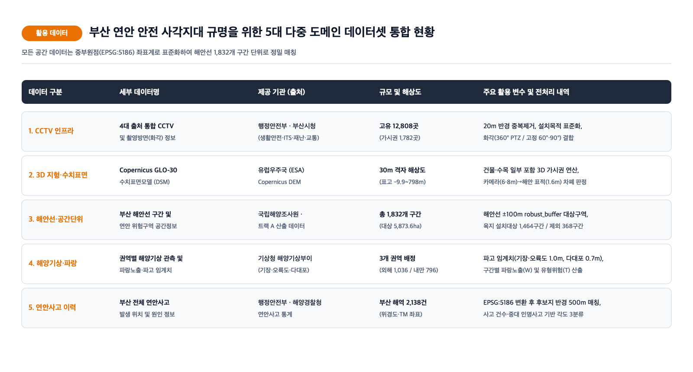

# [섹션 3] 활용 데이터 (포스터 판넬 & 최종 보고서 작성용)

> **포함된 하얀색 배경 시각화 자료 (`./`)**:
> 1. [`fig05_활용데이터_통합구조및정제현황_white.png`](./fig05_활용데이터_통합구조및정제현황_white.png) — 5대 다중 도메인 데이터셋 출처·규모·파생변수 요약표 이미지

---

## 파트 A. 포스터 판넬용 문안 (`우리팀_(테트라워치)포스터양식.pdf` 맞춤)

### [포스터 「활용 데이터」 박스 (표 + 개조식 설명)]

> **💡 포스터 배치 팁**: 포스터 양식의 「활용 데이터」 칸에는 아래 표(또는 [`fig05_활용데이터_통합구조및정제현황_white.png`](./fig05_활용데이터_통합구조및정제현황_white.png) 이미지)를 그대로 삽입하시면 출처와 기관명, 활용 내용이 한눈에 들어옵니다.

| 데이터 구분 | 데이터명 | 제공 기관 (출처) | 규모 및 해상도 | 주요 활용 내용 및 파생 변수 |
| :--- | :--- | :--- | :--- | :--- |
| **CCTV 인프라** | 부산시 다중 출처 CCTV 및 촬영방면(화각) 정보 | 행정안전부 · 부산광역시 (생활안전·ITS·재난·교통) | 고유 **12,808곳** (해안 가시권 **1,782곳**) | 20m 반경 중복제거, 설치목적 표준화, 회전(PTZ 360°)·고정(60°/90°) 화각 결합 |
| **3D 지형 모델** | Copernicus GLO-30 수치표면모델 (DSM) | 유럽우주국 (ESA) | **30m 격자** 해상도 (표고 -9.9~798m) | 건물·수목 일부 포함 3차원 가시권(Viewshed) 차폐 연산 (관측 6·8m → 표적 1.6m) |
| **해안선·공간단위** | 부산 해안선 구간 및 연안 출입통제 공간정보 | 국립해양조사원 · 해양수산부 | **1,832개 해안구간** (대상면적 **5,873.6ha**) | 해안선 ±100m `robust_buffer` 대상구역, 육지 설치대상(1,464구간)/제외(368구간) 분리 |
| **해양기상·파랑** | 권역별 해양기상 관측 및 파랑노출·파고 임계치 | 기상청 해양기상부이 (기장·오륙도·다대포) | **3개 관측 권역** (외해 1,036 / 내만 796) | 파고 임계치(기장·오륙도 1.0m, 다대포 0.7m), 파랑노출($W$)·유형위험($T$)·위험지수 산출 |
| **연안 장소별 사고발생이력** | 부산 연안사고(추락·익수·고립 등 인명사고)의 장소유형 | 해양경찰청 | 부산 **397건** (2017~2023) | 장소유형을 해안선 유형에 대응해 해안유형별 km당 사고율(유형위험 T) 산출 → 위험지수 |
| **해양사고 이력** | 부산 해역 해양사고(선박 사고 포함) 발생 위치 및 원인 | 행정안전부 생활안전지도 | 부산 해역 **2,138건** | EPSG:5186 좌표 변환, 신규 후보지 반경 500m 내 사고·중대사고 매칭 및 촬영각도 3분류 |

---

## 파트 B. 최종 보고서용 본문 (`부경대_최우수상_사례집(보고서).pdf` 양식 참조)

### Ⅲ. 활용 데이터
본 절에서는 연구에 활용한 5대 다중 도메인 데이터를 소개하고, 데이터별 수집 방법 및 공간 매칭·정제를 통해 주요 파생 변수를 산출하는 과정을 단계적으로 설명한다.

#### 표 1. 활용 데이터 목록

| 데이터명 | 출처 (제공 기관) | 비고 (규모 및 주요 변수) |
| :--- | :--- | :--- |
| **부산시 다중 출처 통합 CCTV** | 행정안전부 공공데이터포털, 부산광역시(ITS·재난예경보·교통 API) | 행안부 원본 18,074행(고유 12,429곳·26,840대), 부산 ITS 315곳, 재난예경보 81곳, 교통 238곳 → **20m 중복 제거 후 통합 12,808곳** (`view_type`, `fov_deg`, `purpose_std`) |
| **부산 해역 수치표면모델 (DSM)** | 유럽우주국 (ESA) Copernicus DEM (GLO-30) | 부산 해안 범위 + 2km 버퍼, **30m 해상도 격자(1,828×1,849)**, 표고 -9.9m ~ 798.3m (건물·수목 일부 높이 반영) |
| **부산 해안선 및 연안 구간 정보** | 국립해양조사원 해안선 데이터 및 트랙 A 연안 공간 데이터 | 부산 전체 해안선 **1,832개 세그먼트**, 해안유형(해안가 844, 갯바위 550, 항포구 209, 방파제·테트라포드 150, 미분류 79), 도서부/육지부 구분 |
| **해양기상 파랑노출 및 관측소 임계치** | 기상청 해양기상관측(기장·오륙도·다대포) 및 트랙 A 위험도 지표 | 권역별 파고 임계치(**기장 1.0m, 오륙도 1.0m, 다대포 0.7m** / 풍속 공통 16.9m/s), 노출그룹(외해 1,036구간, 내만 796구간), 유형위험($T$), 파랑노출($W$) |
| **해양경찰청 연안 장소별 사고발생이력** | 해양경찰청 | 부산 **397건** (2017~2023년, 장소유형·사고유형·사고원인, 좌표 없음) |
| **부산 해역 해양사고 발생 이력** | 행정안전부 생활안전지도 해양사고발생현황 | 부산 해역 **2,138건** (발생년월일, X·Y 좌표, 발생유형, 발생원인상세, 기상상태, 발생해역 구분) |

`[표 1]`을 보면, 부산시 해안의 실질적 감시 사각지대와 위험도를 결합하기 위해 단일 기관의 데이터에 의존하지 않고 CCTV·지형·기상·사고의 4개 도메인 데이터를 모두 중부원점(**EPSG:5186**) 좌표계로 통일하여 공간 결합(Spatial Join)을 수행하였다. 구체적인 정제 및 파생 변수 구축 과정은 다음과 같다:

- **① 4개 출처 CCTV 중복 제거 및 화각(FOV) 결합**: 기존 교통 CCTV(238곳)만으로는 해안 안전 감시망을 대표할 수 없어 행정안전부 생활안전 CCTV(유효좌표 18,054행 → 고유 지점 12,429곳), 부산 ITS(315곳), 부산 재난예경보(81곳)를 병합하였다. 출처 간 반경 20m 이내 중복 좌표를 병합하여 최종 **12,808개 통합 지점**을 구축하고, 촬영방면 텍스트에서 회전형(`ptz_360`, 3,193곳)과 고정형(`fixed`, 1,271곳), 미상(`unknown`, 8,344곳)을 파싱하였다.
- **② 해안 가시권 도달 관측점(1,782곳) 추출 및 대상구역(`robust_buffer`) 구축**: 12,808곳 중 해안선 1km 이내 3,856곳을 1차 필터링한 뒤, 카메라 가시거리(300m)가 해안선 ±100m 대상구역(5,873.6ha)에 닿을 수 있는 **1,782개 유효 관측점(`can_reach_zone == True`)**을 최종 추출하였다.
- **③ 육지부 설치 대상(1,464구간) 정제 및 수동 제외 검증**: 전체 1,832개 해안구간 중 전력·통신 인입이 어려운 도서부(섬 325구간)와 위성사진 판독으로 확인된 항만 보안·작업 구역 및 거가대교 침매터널 진입부 등 수동 제외 구간(43구간 등 총 368구간)의 가중치를 0으로 처리하여, 실제 지자체가 CCTV를 설치할 수 있는 **육지부 설치 대상 1,464개 구간**을 확정하였다.
- **④ 해양사고 좌표계 자동 판별 및 500m 반경 공간 매칭**: 행정안전부 부산 해역 해양사고 원본 CSV의 투영 좌표(EPSG:3857 / EPSG:5179)를 분석 표준 좌표계인 EPSG:5186으로 변환하여 총 **2,138건**의 사고 포인트 지오메트리를 구축하고, 각 신규 후보지 반경 500m 버퍼 내 전체 사고 건수(`acc_count_500m`)와 추락·익수·고립·충돌·항계내 등 중대 사고 건수(`severe_acc_500m`)를 산출하였다.
