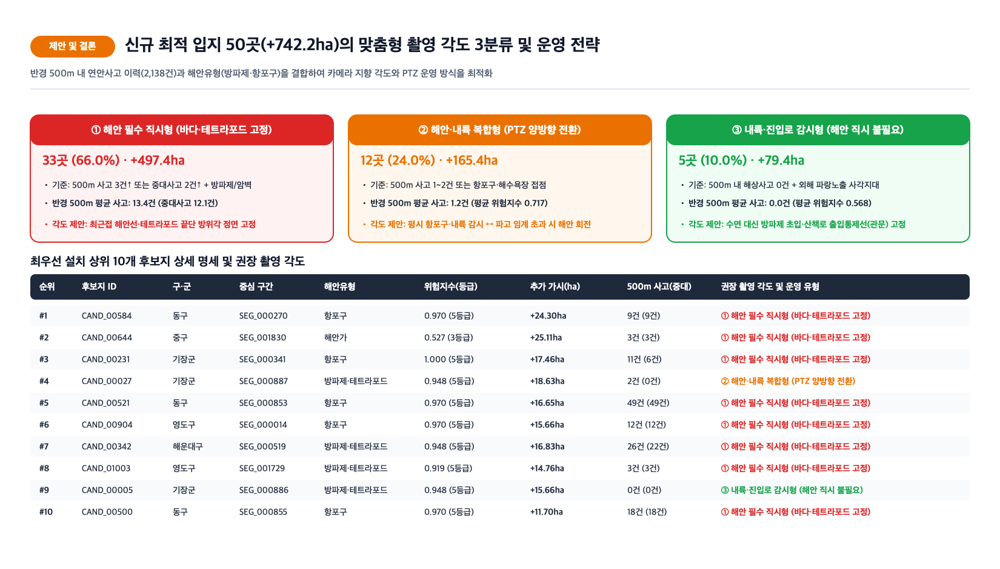

# [섹션 5] 제안 및 결론 (포스터 판넬 & 최종 보고서 작성용)

> **포함된 하얀색 배경 시각화 자료 (`./`)**:
> 1. [`fig09_신규50곳_촬영각도3분류_및_운영전략_white.png`](./fig09_신규50곳_촬영각도3분류_및_운영전략_white.png) — 신규 최적 입지 50곳(+742.2ha)의 촬영방향(각도) 3분류 인포그래픽 및 최우선 상위 10곳 명세표 (하얀 배경)
> 2. [`map01_부산전체_3분류가시커버율_및_상위50곳촬영방향.png`](./map01_부산전체_3분류가시커버율_및_상위50곳촬영방향.png) — 부산 전체 3분류 가시 커버율 및 신규 상위 50곳 촬영방향 지도 (하얀 배경)

---

## 파트 A. 포스터 판넬용 문안 (`우리팀_(테트라워치)포스터양식.pdf` 맞춤)

### [포스터 「제안 및 결론」 박스 (개조식·PPT 형태)]

- **1. 미커버 해안선 신규 CCTV 최적 입지 제안: 「위험도 가중 상위 50곳 우선 설치」**
  - 기존 CCTV가 커버하지 못하는 해안선(74.9% 사각지대) 중 외해 파랑노출($W$)과 해안유형 위험($T$)이 집중된 **기장군(14곳)·남구(7곳)·영도구(7곳)·사하구(6곳)·동구(5곳)·해운대구(4곳)·서구(3곳)·중구(2곳)·강서구(2곳)**의 50개 지점을 최적 신설 입지로 선정
  - 단순 면적 균등 배치 대비 핵심 고위험 미커버 구간(`v4` 34구간) 커버율을 **47.8% → 61.3%(+13.5%p)**로 향상시키며 **총 +742.2ha**의 신규 가시권 확보

- **2. 신규 설치 CCTV의 최적 지향 방향(각도) 제안: 「입지별 촬영 방향 3분류 설계」**
  - 선정된 50개 신규 후보지 반경 500m 내 해양사고 이력(행정안전부 2,138건)과 해안유형을 결합해, **새로 설치할 카메라가 어떤 방향을 바라보게 할지 3유형으로 최적화**:
    - **🔴 ① 해안 필수 직시형 (33곳, 66% / +497.4ha)**: 반경 500m 평균 사고 **13.4건(중대 12.1건)** 다발 구역(1순위 동구 `CAND_00584` 항포구, 3순위 기장 `CAND_00231`, 5순위 동구 `CAND_00521` 사고 49건, 7순위 해운대 `CAND_00342` 사고 26건 등) → **최근접 바다 수면·테트라포드 끝단 방위각을 정면으로 고정 직시**하도록 설치
    - **🟠 ② 해안·내륙 복합형 (12곳, 24% / +165.4ha)**: 잠재 고위험 항포구·갯바위 접점(기장 6곳, 남구 4곳 등, 평균 위험지수 0.717·사고 1.25건) → **360° PTZ 회전형 설치**, 평시에는 내륙 도로·항포구 접안선을 감시하다가 **파고 임계치(기장·오륙도 1.0m, 다대포 0.7m) 도달 시 해안 수면 방향으로 자동 전환**
    - **🟢 ③ 내륙·진입로 감시형 (5곳, 10% / +79.4ha)**: 반경 500m 내 해상사고 0건인 고위험 외해 방파제·해안가(9순위 기장 `CAND_00005` 등) → 넓은 바다 수면을 비추는 대신 **방파제 초입 계단·해안 산책로 출입통제선(진입 관문) 방향을 바라보도록 설치**하여 월파 시 보행자·낚시객 사전 진입 차단

---

## 파트 B. 최종 보고서용 본문 (`부경대_최우수상_사례집(보고서).pdf` 양식 참조)

### Ⅵ. 정책 제안 및 결론
본 연구 결과를 바탕으로 부산광역시 현행 연안안전 시책과 연계하여 **"어느 미커버 해안선에 신규 CCTV를 우선 설치할 것인가"**와 **"신규 설치할 CCTV가 어떤 방향을 바라보게 할 것인가"**에 대한 거시적·미시적 정책 방안을 다음과 같이 제안한다(`<그림 8>` [`fig09_신규50곳_촬영각도3분류_및_운영전략_white.png`](./fig09_신규50곳_촬영각도3분류_및_운영전략_white.png) 참조).

#### 1. 거시적 입지 선정 제안: 부산시·해경 합동 『연안사고 예방 시행계획』 연계 「위험도 가중 상위 50곳」 우선 신설
- 부산시·기초지자체·부산해양경찰서가 합동 추진 중인 **『연안사고 예방 시행계획』(항·포구 및 해안가 사각지대 안전 감시용 CCTV·추락방지막 추가 설치)**의 예산 투입 기준으로, 단순 면적 균등 배분에서 벗어나 파랑 노출과 사고 위험이 집중된 **위험도 가중 상위 50개 후보지(기장군 14곳, 남구 7곳, 영도구 7곳, 사하구 6곳, 동구 5곳 등)** 및 **핵심 사각 34개 구간(`v4`)**에 우선 설치할 것을 제안한다. 이를 통해 총 **+742.2ha**의 위험 해안 가시권을 확보하고, 최우선 사각지대(`v4` 34구간) 커버율을 **61.3%**까지 끌어올릴 수 있다.

#### 2. 미시적 방향 설계 제안: 부산시 지능형·재난예경보 시책과 연계한 「맞춤형 지향 각도 3분류」 도입
- **① 해안 필수 직시형 (33곳, 66% / +497.4ha)**: 반경 500m 내 평균 해양사고가 **13.4건(중대·항계 내 12.1건)**에 달하는 **1순위 동구 항포구(`CAND_00584`, 사고 9건)**, **3순위 기장군 항포구(`CAND_00231`, 위험지수 1.000)**, **7순위 해운대구 방파제(`CAND_00342`, 사고 26건)** 등은 부산시 **『테트라포드 안전사고 예방 지능형 CCTV 구축 및 확대 사업』**과 연계하여 카메라 화각을 최근접 바다 수면 및 테트라포드 끝단 방위각에 **상시 고정 직시**하고 야간 적외선(IR) 및 구조요청 음성인식 기능을 탑재한다.
- **② 해안·내륙 복합형 (12곳, 24% / +165.4ha)**: **4순위 기장군 방파제(`CAND_00027`)**, **11순위 남구 항포구(`CAND_00721`)** 등 잠재 고위험 지점(평균 위험지수 0.717, 사고 1.25건)은 부산시 자연재난과의 **『해안가 재난예경보시스템(재난감시 CCTV) 구축 및 다목적 운영 방침』**을 적용하여 **360° PTZ 카메라**를 신설한다. 평시에는 항포구·내륙 방범을 병행하되, **권역별 파고 임계치(기장·오륙도 1.0m, 다대포 0.7m) 초과 시 해안 수면 방향으로 자동 전환**하고 자동음성통보시스템과 연동한다.
- **③ 내륙·진입로 감시형 (5곳, 10% / +79.4ha)**: 반경 500m 내 해상사고가 0건이나 파랑 위험이 높은 외해 방파제(**9순위 기장군 방파제 `CAND_00005`** 등)는 바다 수면 대신 **방파제 초입 출입통제선(관문) 방향**으로 화각을 고정하고, **『테트라포드 지능형 CCTV 사업』**의 **가상 펜스 침범 자동 인식 및 스피커 경고방송**을 도입하여 월파 위험 시 보행자·낚시객의 사전 진입을 원천 차단할 것을 제안한다.

---

### Ⅶ. 향후 계획
본 연구에서는 유럽우주국(ESA)의 30m 해상도 Copernicus GLO-30 DSM을 활용하여 부산 전역 해안선의 지형 차폐를 일관되게 분석하였으나, 30m 격자 해상도의 특성상 도심 해안가의 개별 소형 건축물이나 방파제 흉벽의 미세한 단차가 평활화되는 한계가 존재한다. 향후 국토지리정보원의 **5m급 정밀 수치지형도(DEM) 및 3차원 건물군(LOD 2 이상 DSM) 레이어**를 결합하고, 선정된 상위 50개 신규 후보지에 대한 **지주 설치 공간·전력 및 통신망 인입 가능 여부**를 현장 실사 데이터로 보완한다면, 즉시 행정 현장에 투입 가능한 고정밀 해안 CCTV 신설 설계도를 완성할 수 있을 것이다.
